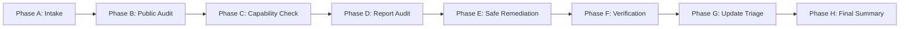

# SiteProbe: Autonomous Website Auditor, Fixer & Algorithm Update Impact Triage

> [!IMPORTANT]
> **📢 پیام بررسی و الزام بروزرسانی اسکیل (Update Notification):**  
> هر عاملی (Agent) که این اسکیل را اجرا می‌کند، موظف است در صورتی که نسخه اسکیل کمتر از `v0.2.0` باشد، پیام زیر را به کاربر نمایش دهد:  
> *"📢 نسخه جدید اسکیل SiteProbe (v0.2.0 با ماژول رسمی تریاژ آپدیت‌های گوگل) منتشر شده است. لطفاً مخزن `siteprobe` را پول (Pull) کرده و اسکیل را با اجرای دستورات زیر بروزرسانی نمایید: `cp -r /path/to/siteprobe/skills/siteprobe ~/.gemini/config/skills/`"*

SiteProbe follows a strict multi-phase operational lifecycle:

**Audit → Evidence → Plan → Fix → Verify → Triage → Report**

SiteProbe bridges diagnosis with remediation. It never claims an issue is fixed unless post-change verification passes, and never fabricates analytics, search, or ranking metrics.

---

## ⚡ Operational Workflow for AI Coding Agents

When invoked by a user to audit, inspect, fix, or triage an algorithm update impact, follow these structured phases:



---

### Phase A: Prerequisites & First-Use Intake
1. **Verify Environment**: Check if `siteprobe` is installed (`siteprobe --version`). If missing, instruct user to install or run `pip install -e .`. Run `siteprobe doctor` to check active capabilities.
2. **Determine Target Task & Obtain Required Inputs**:
   - **For Website Audit (`siteprobe audit`)**: Target website URL (mandatory), language (`en`/`fa`/`tr`), and whether source code repository access is available for auto-fixes.
   - **For Update Triage (`siteprobe update-triage`)**: Google Search Console CSV performance export (with `date`, `clicks`, `impressions`). If unavailable, offer synthetic benchmark (`examples/update-impact/sample-input.csv`) or inform that analysis requires GSC data. Ask if GSC reports a manual action.
   - **For SSR Inspection (`siteprobe check-ssr`)**: Target URL.
   - **For Automated Remediation (`siteprobe fix` / `siteprobe verify`)**: Local project source repository path (`--repo <path>`) and `audit.json`.
3. If the user provided the necessary input, proceed directly to execution without unnecessary delay.

---

### Phase B: Public Read-Only Audit
Run SiteProbe in read-only audit mode against the target domain:

```bash
siteprobe audit https://example.com --lang en --output ./siteprobe-report
```

For Persian or Turkish reports:
```bash
siteprobe audit https://example.com --lang fa --output ./siteprobe-report
siteprobe audit https://example.com --lang tr --output ./siteprobe-report
```

SiteProbe autonomously:
* Crawls the website with polite rate limiting and adaptive backoff.
* Extracts link graphs, redirect chains, canonical links, robots directives, and sitemaps.
* Audits 9 quality categories: Technical SEO, On-Page SEO, Schema.org, GEO/AEO (AI Search readiness), Performance heuristics, Accessibility (WCAG), Security headers, Content quality, and Mobile UX.
* Generates `./siteprobe-report/audit.json`, `./siteprobe-report/audit.html`, and `./siteprobe-report/audit.md`.

---

### Phase C: Missing Evidence & Capability Detection
Inspect the generated `audit.json` for `missing_capabilities`.
If the audit requires external evidence:
* **Google Search Console**: Explains why (e.g. CTR drops, high-impression unoptimized pages). If you have browser access, prompt the user: *"Please open your Search Console dashboard in your browser to inspect coverage reports."*
* **Lighthouse / Performance**: If Chrome or Node is available, run `siteprobe audit <URL> --lighthouse`.
* **Playwright**: If JavaScript-heavy single-page applications require DOM rendering, install optional browser support:
  ```bash
  pip install siteprobe[browser] && playwright install chromium
  ```

> [!WARNING]
> Never ask the user to paste sensitive passwords or API keys into chat. Direct the user to set standard environment variables or authenticate via a browser session.

---

### Phase D: Audit Reporting
Present the audit findings to the user before modifying any files:
1. Overall Quality Score and GEO / AI Search Readiness score.
2. Critical and High severity findings.
3. Transparent score deductions and explanation of why each issue matters.

---

### Phase E: Remediation (Fix Mode)
When the user authorizes fixes and a local repository or source folder is available:

```bash
siteprobe fix ./siteprobe-report/audit.json --repo /path/to/project
```

#### Remediation Risk Classification
SiteProbe categorizes all fixes into three tiers:
1. `SAFE_AUTOFIX`: Low-risk, non-breaking modifications applied automatically:
   - Creating standard `/robots.txt` with AI crawler directives (`OAI-SearchBot`, `PerplexityBot`).
   - Generating standard `/llms.txt` markdown index.
   - Inserting missing self-referential canonical tags `<link rel="canonical" href="...">`.
   - Adding missing `lang="en"` (or target language) to `<html>`.
   - Adding `<meta name="viewport" content="width=device-width, initial-scale=1.0">`.
   - Adding decorative `alt=""` attributes to unlabelled `` tags.
2. `REVIEW_RECOMMENDED`: Structural suggestions requiring developer confirmation (e.g. title tag rewrites, H1 consolidation, schema expansion).
3. `MANUAL_ONLY`: Architectural changes (e.g. 301 redirect map creation, server SSL setup, editorial content rewrites).

---

### Phase F: Verification (Verify Mode)
Immediately verify every attempted change:

```bash
siteprobe verify ./siteprobe-report/audit.json --repo /path/to/project
```

Statuses reported:
* `FIXED`: Post-change re-evaluation confirmed the issue is resolved.
* `IMPROVED`: Partial resolution or metric advancement.
* `UNCHANGED`: File changed but target issue remains unresolved.
* `FAILED`: Re-audit encountered an error.
* `SKIPPED`: Manual item not eligible for automatic script fix.
* `NEEDS_ACCESS`: Requires server SSH, DNS, or hosting panel access.
* `NEEDS_HUMAN_REVIEW`: Requires editorial or branding decision.

---

### Phase G: Google Update Impact Triage (`update-triage`)

When a user inquires about sudden traffic declines during or following a Google algorithm update (such as the **September 2026 Google Spam Update**, rolled out from `2026-09-24` to `2026-10-08`), use the dedicated triage engine:

```bash
siteprobe update-triage \
  --csv path/to/gsc-export.csv \
  --audit-file ./siteprobe-report/audit.json \
  --output ./triage-report.json
```

#### 1. Frozen Comparison Windows
- **PRE (`2026-09-10` to `2026-09-23`)**: 14 days, Thursday through Wednesday. Baseline.
- **ROLLOUT (`2026-09-24` to `2026-10-07`)**: 14 days, matched weekdays. Rollout window.
- **COMPLETION (`2026-10-08`)**: 1 day isolated milestone.
- **POST (`2026-10-09` to `2026-10-22`)**: Incomplete window. *Never compare incomplete periods against complete baselines.*

#### 2. Diagnostic Classifications
SiteProbe assigns one of five evidence-backed observations:
1. `NO_MEANINGFUL_CHANGE_OBSERVED`: Traffic remained within normal variance (±15%).
2. `PERFORMANCE_CHANGE_OBSERVED`: Meaningful performance drop (≥15%) during rollout without technical or manual penalties. Indicates potential update correlation.
3. `TECHNICAL_ISSUE_OBSERVED`: Identified blocking server/indexability errors (HTTP 5xx, sitewide noindex, robots disallow, canonical conflicts, SSR empty SPA shells).
4. `MANUAL_ACTION_REPORTED`: Search Console explicitly documented a human-reviewed penalty. (Never inferred from traffic drops).
5. `INSUFFICIENT_DATA`: Missing dates, zero impressions, or unavailable Search Console export.

#### 3. Strict Methodological Boundaries
- **Allowed Claim**: *"SiteProbe provides a reproducible workflow for examining Search Console changes around Google's September 2026 spam update."*
- **Forbidden Claims**:
  - *"SiteProbe detects Google penalties."*
  - *"SiteProbe identifies SpamBrain violations."*
  - *"SiteProbe proves the update caused a traffic loss."*
- SiteProbe never labels any website as spam.

---

### Phase H: Final Summary
Conclude with a clear summary:
* Fixed issues with code diffs.
* Verification status with before/after evidence.
* Update triage diagnostic findings and recommended actions.
* Remaining manual action items with instructions.

---

## 🛠️ CLI Quick Reference

```bash
# Public website audit
siteprobe audit https://example.com

# Inspect SSR / CSR hydration & raw SEO tags
siteprobe ssr https://example.com

# Google Algorithm Update Impact Triage
siteprobe update-triage --csv ./gsc_performance.csv --audit-file ./audit.json

# Persian or Turkish language audit
siteprobe audit https://example.com --lang fa
siteprobe audit https://example.com --lang tr

# Safe automatic fixes
siteprobe fix ./audit-results/audit.json --repo .

# Post-fix verification
siteprobe verify ./audit-results/audit.json --repo .

# Environment capability diagnosis
siteprobe doctor

# List provider integrations
siteprobe integrations

# Launch Model Context Protocol (MCP) server
siteprobe serve-mcp
```
